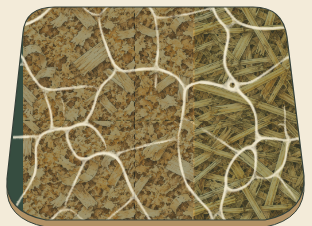
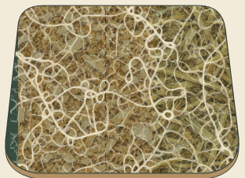
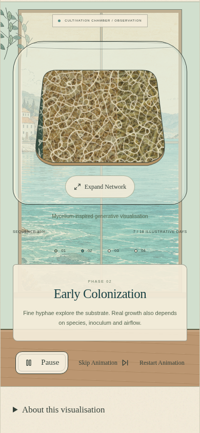
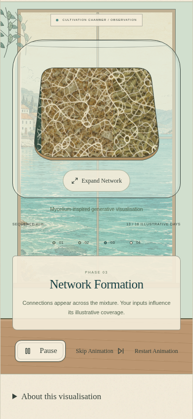
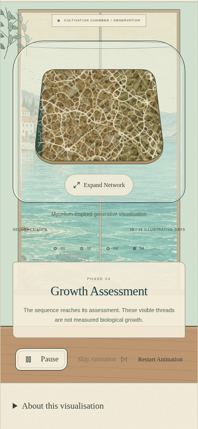

# Denser Physarum trail field — visual review

This branch only refines procedural growth and its rendering. It starts from `main` at `cfe309f` (merged PR #5). It does not change visitor initialization, inline recipe controls, notebook storage, experiment navigation, scientific rules or the four outcome categories. No new dependencies, merge or production deployment are part of this PR.

## Watch and compare

- [New 20-second mobile recording](review/dense-network/after.mp4): the whole vessel during emergence and assessment, then the same living field in expanded observation and Pause.
- [Previous version, expanded recording](review/dense-network/before.mp4): a 5.5-second segment captured from `cfe309f`, before editing. The previous network already formed loops; this comparison is against that version, not the older radial renderer.
- [Instructor’s original reference video](https://www.pavelp.cz/assets/img/cpp_slime_mold.webm) and [article](https://www.pavelp.cz/posts/eng-cpp-slime-mold-simulation/).

Both BLUEGREEN recordings are actual Chromium output at 390 × 844 using sawdust 60%, straw 40%, moisture 62%, 24°C, 18 days and treated substrate. They use the same recipe-derived seed. Capture metadata: [before](review/dense-network/before-recording.json), [after](review/dense-network/recording.json). Different runtime costs mean wall-clock captures are not identical iteration counts. The fixed-step comparison below controls for that difference.

| Previous close-up | Revised close-up |
| --- | --- |
|  |  |

| Emergence | Network formation | Continuing at assessment |
| --- | --- | --- |
|  |  |  |

[Full expanded screenshot](review/dense-network/expanded.png). The close-ups above are element screenshots of the actual vessel, without synthetic added filaments. Reference media is linked, not rehosted.

## What changed

The previous shared sensor range and strong turns rapidly concentrated the population into a few large routes. More agents alone did not prevent that coarsening. The new shorter, narrower sensors and gentler turns preserve many smaller circuits and crossing connections. Higher agent density repeatedly reinforces those fine routes. Uniform initial distribution, three-direction trail sensing, movement followed by deposition, toroidal boundaries, double buffering and ongoing evolution remain intact. No outward steering, agent retirement, permanent branch skeleton or terminal animation frame was introduced.

| Favourable-profile visual parameter | Previous | Revised |
| --- | --- | --- |
| Initial mobile simulation field | 320 × 224 | 384 × 264 |
| Agents per cell | 0.40 | 0.70 |
| Full mobile population | 28,672 | 70,963 (2.48×) |
| Intermediate field / population | — | 320 × 224 / 50,176 |
| Constrained-device field / population | 192 × 136 / 10,445 | 256 × 176 / 31,539 |
| Desktop starting field | 448 × 304 | 512 × 352, subject to calibration |
| Sensor distance | 4.3 cells | 3.6 cells |
| Sensor angle | 0.417 radians | 0.25 radians |
| Turn angle | 0.95 radians | 0.70 radians |
| Trail deposit per visit | 1.40 | 1.55 |
| Spatial diffusion | 0.01 per neighbour | 0.004 per neighbour |
| Evaporation multiplier | 0.77 | 0.77, retained to clear abandoned routes |
| Movement / boundaries | 1 cell per step / wrap | Retained; all agents stay active |
| Lifetime / requested cadence | Unbounded / 90 steps per second | Retained, bounded by frame work |

All these are **artistic simulation parameters**, not experimental fungal measurements. Other visual profiles retain their relative density/deposit differences and existing visibility masks. They do not feed back into `evaluate()`.

Less diffusion preserves fine ridges. The rendering cutoff rises from 0.35 to 0.85 to remove weak background haze; maximum ink opacity and the material artwork are unchanged. There is no stroke-width or blur increase. The density comes from the trail field itself.

The instructor’s early reference is a fine mesh that later coarsens. This preset aims to sustain the richer early structure during exhibition viewing. It is a Physarum-inspired adaptation, not an exact reproduction or a biological mycelium predictor. Existing attribution and MIT notice are retained.

## Sustained complexity

A fixed seeded field comparison measures enclosed gaps in the **raw simulation**, before colour, alpha or Canvas scaling. It thresholds trail values at 2.5, counts 4-connected enclosed gaps of at least six cells, and uses 8-connected occupied cells to check connectivity. Counts describe this artistic algorithm only; they are not biological metrics. See [topology.json](review/dense-network/topology.json).

| Field | Step | Enclosed gaps | Trail area above threshold | Largest connected trail share |
| --- | --- | --- | --- | --- |
| previous 320 × 224 | 720 | 23 | 12.6% | 95.9% |
| previous 320 × 224 | 3,000 | 5 | 8.0% | 95.2% |
| revised 384 × 264 | 720 | 261 | 32.0% | 95.3% |
| revised 384 × 264 | 3,000 | 265 | 31.5% | 94.6% |
| revised-low 256 × 176 | 720 | 118 | 33.1% | 95.9% |
| revised-low 256 × 176 | 3,000 | 117 | 31.8% | 94.7% |

The regression test requires the constrained 256 × 176 field to retain over 80 enclosed gaps, over 85% of occupied cells in its largest connected component, and an open mesh rather than a near-solid field at both 720 and 3,000 steps. An opacity increase cannot satisfy this test. Extended fields were also visually inspected at 720, 2,500 and 7,000 steps. [Raw field comparison](review/dense-network/extended-field.png), left to right in that order, is rendered directly from the same model with the final alpha mapping; it is an engine diagnostic, not a browser screenshot.

## Performance and preserved interaction

Before the visible run, an eight-step probe estimates suitable field size from measured step cost. It steps down through 384, 320 and 256 as needed, respecting the initial viewport/memory tier. The chosen field stays fixed through Replay, Expand and resize. Field state is never replaced halfway through observation.

Optimisations retain network complexity:

- Fixed colour and habitat opacity are cached once; only pixel alpha changes each frame.
- Canvas backing resolution follows visible size and device pixel ratio, capped at 2. It no longer rasterises a 1000-pixel image for a 310-pixel dialog on a 1× screen. Source simulation resolution remains independent.
- A rotating approximately 0.2% exploratory cohort replaces random selection on every already-following agent. Every agent still moves and deposits every step. Agents in unmarked regions can still explore.
- Only the visible surface paints; reusable typed arrays, trigonometry tables, short work slices, bounded diagnostics and hidden-tab suspension are retained.

The production-build observations below used expanded view for six seconds, separately at 1× and 4× Chrome DevTools CPU throttling, with no simultaneous test suite or video encoding. The baseline used the same harness. [Before measurements](review/dense-network/before-performance.json), [final measurements](review/dense-network/performance.json).

| CPU emulation | Previous agents / field | Revised agents / field | Revised frame interval p50 / p95 | Revised work p95 | Pause round trip |
| --- | --- | --- | --- | --- | --- |
| 1× | 28,672 / 320 × 224 | 70,963 / 384 × 264 | 16.7 / 16.8 ms | 13.0 ms | 55 ms |
| 4× | 10,445 / 192 × 136 | 31,539 / 256 × 176 | 16.7 / 16.8 ms | 18.0 ms | 256 ms |

Maximum frame intervals were 33.3 and 33.4 ms respectively. Work slices may exceed the nominal 7 ms when the current step finishes. Under throttling the engine advances fewer steps per second; the independent educational phase clock still behaves as before. These short desktop-emulation samples are not physical-phone benchmarks or guaranteed frame rates. Pause timings include Playwright actionability and browser round trips. Heap samples describe the whole page, not a retained-memory/leak test.

Validation completed: **26 unit tests passed**, and **all 24 browser scenarios were verified** across the full run and a focused recheck. The initial full run passed 23/24; the dense reconstruction check exceeded its old five-second wait. Its exact 720-step, clipping and deterministic Replay assertions pass with a 15-second reconstruction allowance, keeping simulation work time-sliced. Production build and `git diff --check` passed.

Browser checks cover fresh empty visitors, inline ratios, stirring, notebook retention/privacy, all four outcomes, natural completion, reduced motion, hidden-tab suspension, static fallback, page layouts, asset base paths, deployment updates and input-specific feedback. The expanded-view check now also resizes the paused surface and verifies that restoring its dimensions restores the same pixels without advancing or replacing the network. The PR workflow reruns the full suite independently.

Run `npm test`, `npm run build`, and `npm run test:e2e`.

## Review locally

```sh
npm ci
npm run dev
```

Open `/Blue-Green/` on the forwarded development port 5173. For a production preview, use `npm run build` then `npm run preview` on port 4173, with the same base path. This branch does not change GitHub Pages configuration or production `main`.
