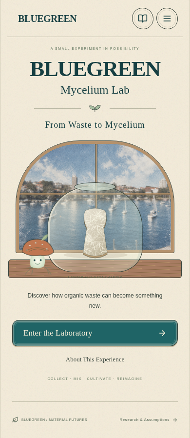
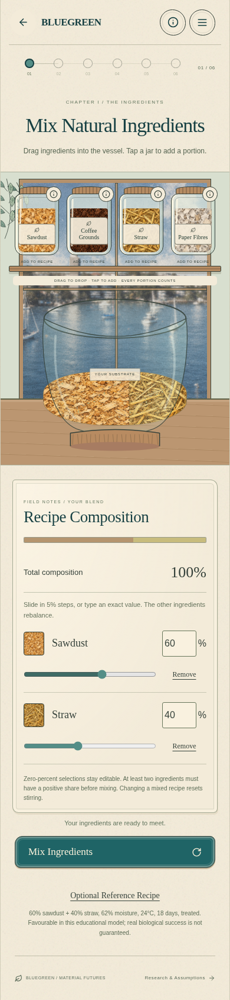
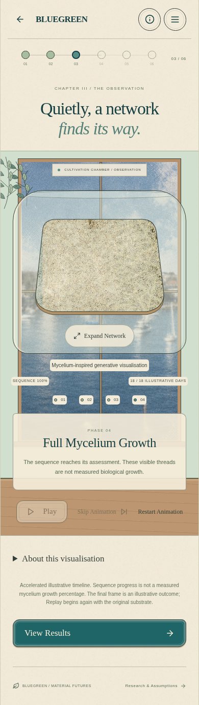

# Entry flow and neutral growth wording

## Scope

The landing subtitle is now **From Waste to Mycelium**, with the original styling retained. Enter the Laboratory opens the existing Collect & Mix screen directly, with an empty vessel and recipe. The introductory screen and its navigation button are removed; the remaining six journey buttons and chapter labels are renumbered. Material descriptions remain available through each mixing-screen jar’s information button.

Existing numeric checkpoint IDs are retained for compatibility. A stored step 1 or an old browser-history entry maps to the functional mixing screen, rather than displaying an obsolete or blank page.

## Explicit resume and notebook preservation

Reloading opens the landing page with a blank active recipe. A recoverable session checkpoint is kept separately until **Resume Previous Experiment** is selected. Repeated landing-page reloads retain that checkpoint. Resume restores its recipe, conditions, progress and result reference, with animation paused. Enter and new-experiment actions discard only the active checkpoint and reset the recipe, stirring, growth and result state. Existing completed records and notebook privacy handling remain intact.

Device history continues to merge without pruning or reevaluation. Historical explanations use neutral growth wording in results, details and comparison; their stored text is not rewritten. This also covers feedback snapshots saved by earlier versions.

## Growth language

The observation sequence uses **Growth Begins**, **Mycelium Spreads**, **Network Development** and **Full Mycelium Growth** for the favourable visual ending. Other outcome endings retain **Growth Assessment**, to avoid implying full growth for incomplete, risk or unverified results. Scientific caveats remain visible: this is stylised imagery, sequence percentage is not measured biological growth, and the artwork does not predict real morphology, speed, contamination or material performance.

The growth algorithm, quality presets, progressive network behaviour and educational evaluation rules are unchanged. Internal algorithm identifiers and historical review documents are retained; they are not interface text.

## Supplied harbour background

`public/images/harbour-background.png` is a byte-for-byte copy of the supplied `design-references/harbour-background.png.png` (1154 × 870). It replaces the old scenery through the shared `CoastalWindow` in `src/components/Illustrations.jsx`, covering the landing page and every laboratory window in mixing, stirring, conditions and observation. Results, lifecycle and notebook do not use the old scenery. The previous image remains in the retained asset collection for provenance, with no rendering references in the interface.

Images retain `object-fit: cover`. The existing beige window tint and scene-specific opacity reductions were removed so the supplied muted blue colours, grain and soft focus remain unchanged. Small instruction and observation labels receive ivory backing for contrast; this does not tint the image or move the controls. No new blur, filter, colour processing or controls were added. The existing Vite asset manifest generates content-hashed image URLs under `/Blue-Green/`; GitHub Pages configuration is unchanged.

## Verification

- **28 unit tests pass**, including all four evaluation outcomes, the 60/40 reference recipe, pending checkpoints, fresh starts, history retention and historical wording.
- **All 27 Chromium browser cases pass across the complete run and focused rechecks**. Coverage includes the full journey, all outcomes, manual/automatic stirring, inline percentages, notebook comparison/privacy, explicit resume, retired-screen checkpoints, old explanations and unchanged stored records, expanded growth, reduced motion, hidden tabs, cache updates and production assets.
- **Production build and `git diff --check` pass**. The harbour copy has the same SHA-256 as the supplied source: `b2a1b0296b5ff0d9e72eee823573d969a61dfe166034aa98d3d76302cc593559`. Its runtime URL is `/Blue-Green/assets/harbour-background-b2a1b0296b5f.png` and returns `200 image/png`.
- Browser assertions verify loaded image dimensions, cover scaling, no filter, full window opacity and no rendered old-background image. Layout checks cover 320, 390, 768 and 1440 px widths. Visible current and historical text is checked for the retired biological terms; remaining source matches are internal algorithm identifiers/comments, not interface copy.
- `src/growthModel.js`, `src/simulation.js`, `src/components/RecipeComposition.jsx`, Vite configuration and the Pages deployment workflow remain unchanged.

The final label-contrast styling was rebuilt and rechecked through the complete journey, responsive asset checks and the new presentation cases. The following captures come from the real production preview, with no screenshot compositing:

| Landing | Mixing with inline sliders | Completed growth |
| --- | --- | --- |
|  |  |  |

Also review the [results screen](review/entry-and-language/results-mobile.png) and [desktop landing](review/entry-and-language/landing-desktop.png). The existing shapes, panels, typography and interaction layout are preserved.

## Modified files

- `src/screens.jsx`, `src/main.jsx` and `src/data/research.js`: subtitle, direct entry, progress navigation, checkpoint compatibility and growth labels/help.
- `src/state.js`: pending session checkpoint and explicit resume; device-history logic is unchanged.
- `src/components/Illustrations.jsx`, `src/style.css` and `public/images/harbour-background.png`: supplied scenery, responsive cover scaling and removal of tint/opacity overrides.
- `src/text.js`, `src/components/Results.jsx`, `src/components/Notebook.jsx`, `src/components/GenerativeGrowth.jsx` and `src/outcomeFeedback.js`: neutral current and historical presentation, including evidence caveats.
- Unit/browser tests, `README.md` and this review: regression coverage and documentation. No dependencies or deployment configuration changed.
