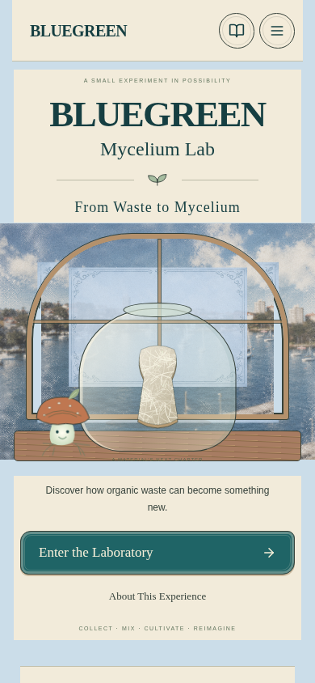
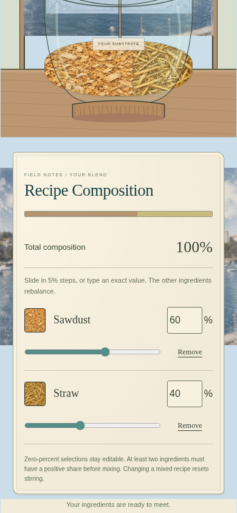
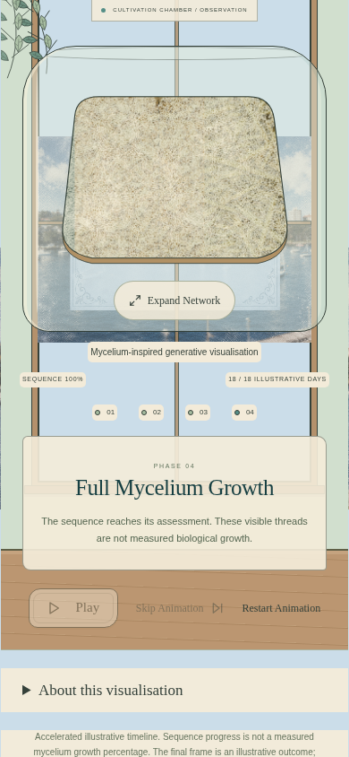
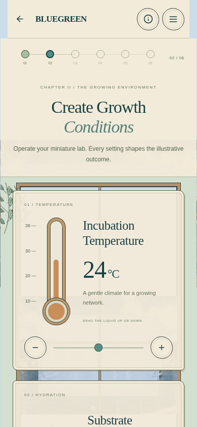
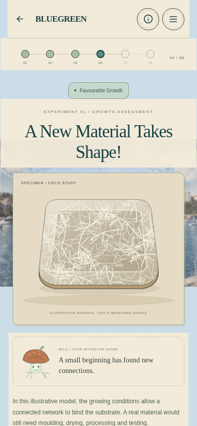
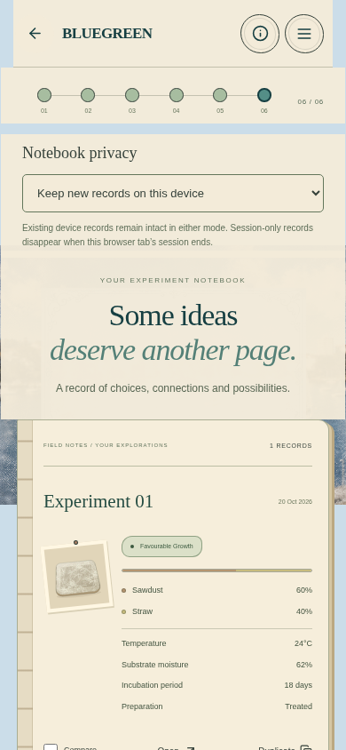

# Framed harbour background review

## Supplied asset and scope

`public/images/framed-harbour.png` is an unchanged copy of `design-references/new background.png` (1076 × 808, RGBA). Both files have SHA-256 `6d17b8bfef1ce7e02d6c8f8b1be091ed0080435abaa10bdaeed0f00564503bbc`.

A single shared `ExperienceBackground` in `src/components/Illustrations.jsx` is mounted outside the animated screen content. It remains present on landing, mixing, stirring, conditions, growth, results, lifecycle, notebook and informational overlays, including screen transitions and long-page scrolling. The existing laboratory windows reference the same new image. No previous scenic image is rendered. Ingredient and substrate textures remain in use; they are material illustrations rather than page scenery.

The backdrop and windows use **contain**, centered in their existing containers. This fits the entire supplied composition rather than trimming the decorative rectangle. On portrait devices the landscape artwork is letterboxed in pale blue. On desktop the image fills more of the viewport while retaining its aspect ratio. The frame remains part of the supplied image; no CSS recreation, recolouring or extra blur is applied. Existing interface objects can sit in front of the background, as before.

The former page-level generated paper texture is removed. Existing text groups gain ivory backing to retain contrast against the scenic edges. Their typography, dimensions, spacing, buttons and layout are unchanged. The background is decorative, hidden from assistive technology and cannot capture pointer input.

## Retained language and gameplay

These requested refinements are already present in the merged baseline and remain in place:

- **From Waste to Mycelium** on the landing page.
- Enter the Laboratory opens the empty, functional mixing screen directly. The old introduction is absent; historical navigation references map to mixing.
- Growth Begins, Mycelium Spreads, Network Development and Full Mycelium Growth for the favourable visual ending. Other endings retain Growth Assessment to avoid implying full growth for risk or uncertain results.
- Scientific caveats, neutral current/historical explanations, four outcome categories, progressive dense network growth, visible recipe sliders, new-experiment reset and explicit Resume.
- Completed history, notebook privacy, comparison and retry. No changes to simulation rules, growth parameters or state/storage logic in this update.

## Modified files

- `src/components/Illustrations.jsx`: shared asset reference and persistent backdrop component; updated window image.
- `src/main.jsx`: mount the decorative backdrop outside page transitions.
- `src/style.css`: centered responsive fitting, pale blue fallback and text contrast backing; remove the old page texture.
- `public/images/framed-harbour.png`: exact supplied image copy.
- `e2e/game.spec.js`: assert the shared image remains mounted, loads, fits the viewport, uses the correct production URL and replaces old scenery across the journey and responsive layouts.
- `e2e/cache.spec.js`: check the new hashed runtime image and observe both Chromium memory-cache and disk-cache reuse.
- `README.md`, this review and browser screenshots: documentation and review evidence.

## Verification

- **28 unit tests pass**; all four outcomes and the illustrative 60/40 reference recipe retain their existing behavior.
- **All 27 browser cases pass across the full run and focused rechecks**: complete journey, responsive layouts, inline recipes, stirring, natural and skipped growth, result categories, history/privacy, comparison, fresh starts, explicit Resume and neutral historical text.
- The cached-context test verifies real browser cache reuse through Chromium memory/disk signals, the update prompt and preservation of recipe/history. A fresh context uses the normal URL. Production output retains coherent version metadata and hashed JS, CSS and runtime images.
- Background assertions cover 320, 390, 768 and 1440 px widths; the same background node survives navigation and scrolling. Images load with their actual 1076 × 808 dimensions, centered contain fitting, no filter and full opacity. No old scenic image appears in the rendered interface.
- The complete journey was rerun after the final contrast adjustment. Real-browser captures include mobile and desktop, long-page sections and an informational overlay; capture runs reported no JavaScript errors.
- `npm run build` and `git diff --check` pass. The new `/Blue-Green/assets/framed-harbour-6d17b8bfef1c.png` asset returns **200 image/png** from the production preview.
- Growth, recipe/state/storage code, scientific evaluation, dependency files, Vite configuration and GitHub Pages workflow are unchanged.

The review validates a production build served under `/Blue-Green/`. The production website is not changed by this branch; public Pages deployment still requires the reviewed changes to be merged by the user.

## Browser captures

These are uncomposited browser screenshots. Mobile captures use 390 × 844; the desktop capture uses 1440 × 1000. Some captures show a scrolled viewport to make the retained controls and explanations visible.

| Landing | Inline recipe controls | Completed growth |
| --- | --- | --- |
|  |  |  |

| Conditions | Results | Notebook |
| --- | --- | --- |
|  |  |  |

Also inspect the [desktop landing](review/framed-background/landing-desktop.png), [lifecycle detail and text contrast](review/framed-background/lifecycle-details-mobile.png), [input-specific result explanation](review/framed-background/results-explanation-mobile.png), [empty mixing scene](review/framed-background/mixing-mobile.png) and [informational overlay](review/framed-background/information-mobile.png).
