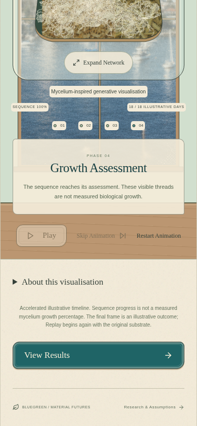
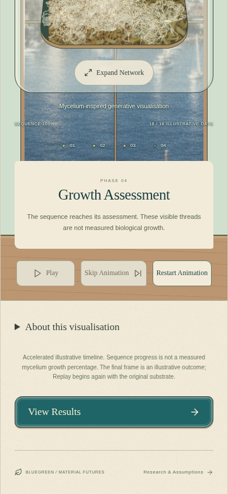

# Growth UI visual integration

## Scope

The only application file changed is `src/style.css`. This patch uses current main as its baseline and preserves the previous framed-background revert. No image, JSX, page structure, text, growth engine, recipe/evaluation logic, experiment storage, dependency or deployment configuration is changed.

The reported **Growth Assessment** surface is the `.phase-explanation` block in `GrowthScreen`, also used for the other observation phases. The separate `ResultPanel` was checked on mobile and desktop; its intentional specimen and summary surfaces remain intact.

## Styling changes

- Observation captions are transparent: `.generative-label`, `.chamber-progress > span`, `.growth-phase-dots > span` and `.chamber-label`, scoped to `.growth-screen`. The cream fills, spread shadows and label borders are removed. Light ivory type with a small dark teal text shadow stays legible against the harbour without a rectangular backing. The coloured phase dots remain intact.
- `.phase-explanation` uses solid parchment (`#f3ebd9`) instead of a translucent fill. Its border becomes transparent while retaining its dimensions, so the artwork cannot show through and the text does not shift. Its title, description, phase label, padding, height and position remain unchanged.
- `.growth-screen .growth-playback > button` gives Play/Pause, Skip Animation and Restart Animation one cream surface, one border, matching Georgia typography, consistent hover colours and 44 px minimum height. The inherited inner-frame pseudo-element and inset/drop shadows are removed. Disabled controls use muted opaque colours instead of the global 42% opacity, and keep those colours on hover. Keyboard focus styling remains available.
- Control spacing is normalised within the existing flex row. It stays one row at the primary 390 px viewport and retains wrapping on compact screens. Ingredient instructions keep their existing styling; the glass vessel, reflection, specimen illustrations and purposeful interactive surfaces are preserved.

## Geometry and browser evidence

Before/after captures use the same illustrative 60% sawdust / 40% straw recipe, 45% substrate moisture, 24°C, 18 days and treated substrate, producing the existing Incomplete Growth category and Growth Assessment heading. The visible network coverage is identical before and after at each viewport; these numbers are artistic raster diagnostics, not biological measurements.

At 390 × 844 and 1440 × 1000, the caption, sequence row, phase-indicator row and assessment panel retain identical x/y positions, widths and heights. Playback controls retain their vertical positions and 44 px heights; horizontal shifts are at most 14 px as their padding, type and spacing are standardised. Raw [before](review/growth-integration/before.json), [after](review/growth-integration/after.json) and [control checks](review/growth-integration/controls.json) are included.

These are real browser screenshots, scrolled to show the observation captions and controls together; no screenshot compositing or artwork editing was used.

| Mobile before | Mobile after |
| --- | --- |
|  |  |

Compare the [desktop before](review/growth-integration/before-desktop.png) and [desktop after](review/growth-integration/after-desktop.png). The unchanged result layout is shown on [mobile](review/growth-integration/result-mobile.png) and [desktop](review/growth-integration/result-desktop.png).

## Validation

The production build and 28 unit tests pass. Focused real-browser checks passed for transparent annotations, the opaque assessment surface, matching active button styles, active hover, disabled hover, Play/Pause, Restart, Skip, keyboard focus/activation, 44 px control targets and fit at 320/390/768/1440 px widths. Capture runs reported no JavaScript errors. All **27 existing browser tests pass**, including the full journey, all outcome categories, cached updates, reset/Resume, history/privacy/comparison, natural growth, expanded observation, Replay and fallback behavior. `git diff --check` also passes.
