# Network observation and educational feedback review

This refinement changes the growth artwork and result explanations. It preserves fresh visitor starts, inline recipes, stirring, condition controls, the Reference Recipe, notebook records, version checking and the Pages configuration. It does not change `RULES`, `evaluate()`, model version 2, or any outcome threshold.

## Watch the actual captures

All recordings use Chromium at a 390 × 844 viewport and the same reference inputs: sawdust 60%, straw 40%, substrate moisture 62%, 24°C, 18 days and treated preparation.

- [Previous animation](review/network-refinement/before.mp4): captured from main at `fde52d8` before editing the growth engine.
- [Revised animation](review/network-refinement/after.mp4): preparation, emerging network and continued evolution after the educational sequence reaches 100%.
- [Expanded observation](review/network-refinement/expanded.mp4): a later segment of that **same continuous recording**, including Pause, Replay and Return to Laboratory. It does not start a second simulation when expanded.
- [Original instructor reference video](https://www.pavelp.cz/assets/img/cpp_slime_mold.webm), accompanying [article](https://www.pavelp.cz/posts/eng-cpp-slime-mold-simulation/).

The captures are actual browser output. See [recording metadata](review/network-refinement/recording.json) for the selected quality, population and event times. Reference media is linked rather than rehosted.

| Previous BLUEGREEN                                             | Revised observation                                                   |
| -------------------------------------------------------------- | --------------------------------------------------------------------- |
| 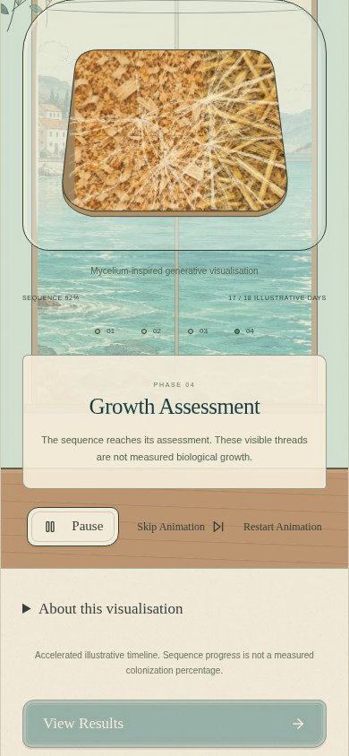 | 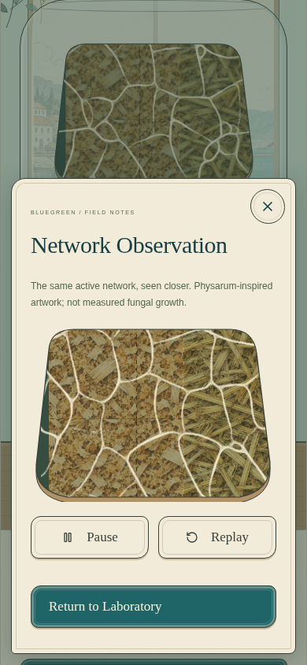 |

| Early colonisation                                    | Network formation                                                   | Mature evolving network                                 |
| ----------------------------------------------------- | ------------------------------------------------------------------- | ------------------------------------------------------- |
| 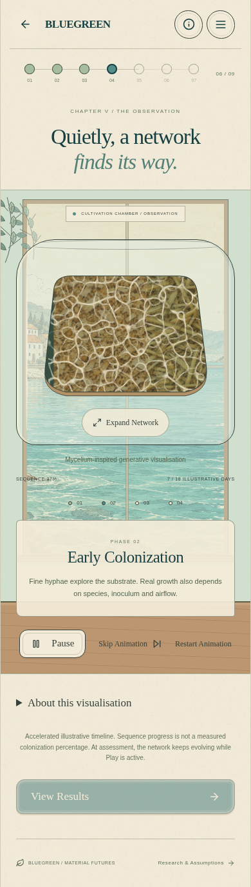 | 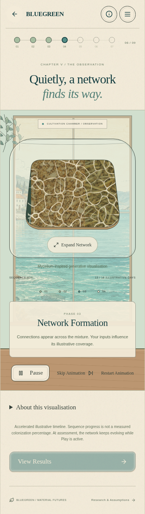 | 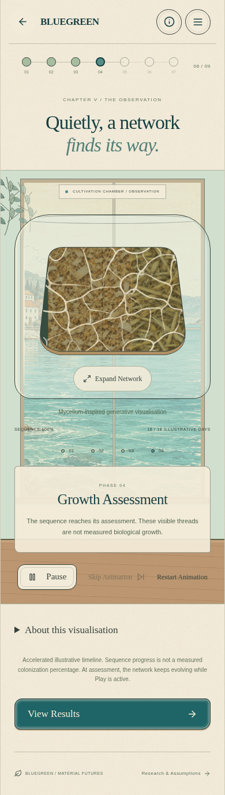 |

| Favourable                                               | Incomplete                                               | Illustrative risk                                      | Unverified                                                    |
| -------------------------------------------------------- | -------------------------------------------------------- | ------------------------------------------------------ | ------------------------------------------------------------- |
| 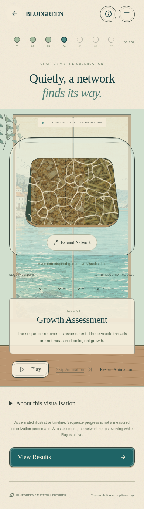 | 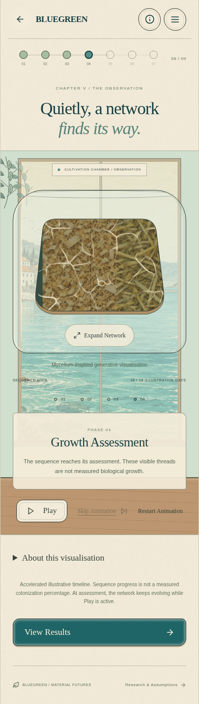 | 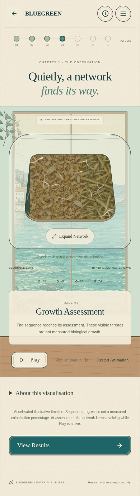 | 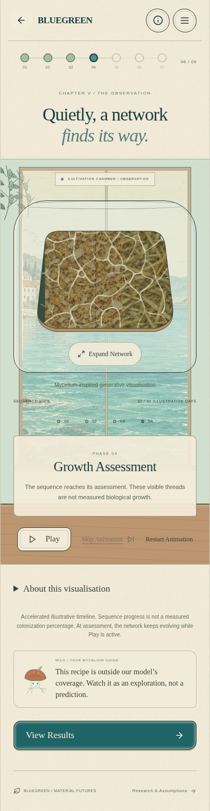 |

## Reference comparison and algorithm

The reference source was inspected at commit `7dc0ab46948e59798f1c71f0182e0e9b310191ed`, particularly `slime_mold_simulation.cpp` and `presets.cpp`. Video frames at 1, 8 and 16 seconds show an early dense mesh coarsening into larger connected loops, with routes merging, moving and fading. Its GUI screenshot uses approximately 0.417-radian sensing, 4.291-cell sensors, 0.957-radian turns and 0.771 evaporation. The reference's method called `diffuse` actually performs evaporation only.

The previous BLUEGREEN model used 220 favourable-profile agents, four directional inoculation sites, an outward bias, boundary retirement and a terminal 240-iteration sequence. Its persistent display traces reinforced the radial appearance. The new model seeds agents across the field with random headings, senses forward/left/right, follows stronger trails, deposits after movement and wraps at boundaries. No agent is retired for reaching an edge. A separate buffer applies spatial diffusion and evaporation, so abandoned routes disappear while repeatedly visited paths reinforce themselves. There is no permanent drawn branch skeleton or outward steering rule.

| Visual parameter        | Current favourable profile                                                                     |
| ----------------------- | ---------------------------------------------------------------------------------------------- |
| Initial mobile field    | 320 × 224 cells; smaller tiers for low memory or a slow initial calibration                    |
| Agent density           | 0.40 agents per field cell: 28,672 at the initial mobile tier, versus 220 previously           |
| Sensor distance / angle | 4.3 cells / 0.417 radians                                                                      |
| Turn / movement         | 0.95 radians / 1 cell per simulation step                                                      |
| Deposition              | 1.4 per visit; other profiles add a small artistic spatial modulation                          |
| Diffusion / evaporation | Cross kernel: 0.96 centre + 0.01 per neighbour; multiply by 0.77                               |
| Live cadence            | Approximately 90 requested steps per second; bounded work can slow this on constrained devices |
| Skip/recovery milestone | 720 steps; **not** a lifetime limit                                                            |

All numbers in this table are **artistic algorithm parameters**, not fungal growth data. Other profiles retain the same sensing/steering/diffusion system. Agent density, deposition and an explicitly artistic visibility mask make incomplete growth uneven, risk restricted, and unverified growth exploratory. The mask does not identify contaminated regions. No visual value feeds back into the scientific result.

The educational stage clock and engine iterations are separate. Preparation displays no network. Early stages reveal the field progressively without resetting it. Reaching Growth Assessment leaves the network evolving while Play remains active. Skip brings an earlier field to a seeded 720-step assessment minimum in short work slices and pauses; a field already beyond that count is retained. Replay uses the same seed and chosen field size. Same-tab refresh reconstructs a seeded stage frame, rather than storing every live particle; it is not an exact particle-level continuation after a reload.

One engine owns both observation surfaces. Its observation dialog is portalled to the document body so scene stacking/animation cannot obscure its controls; a stable close callback preserves focus during stage updates. The expanded view receives the same field; the obscured laboratory canvas is not repainted unnecessarily. Closing the observation repaints the laboratory from that field without resetting or advancing it. Glass reflections and a final outline remain above the precisely clipped network. Existing ingredient textures are retained with a muted contrast treatment.

## Performance observations

The implementation uses Float32/Uint16 agent arrays, precomputed angle tables, double-buffered fields and reusable RGBA/Canvas buffers. No worker, WebGL library or runtime dependency was added. Each animation frame gets a short simulation budget (7 ms, allowing the current step to finish), at most 12 catch-up steps, and bounded diagnostic samples. Hidden pages stop scheduling work. Reduced-motion users start paused and can choose Play. Canvas/Path2D failure produces a labelled static mesh.

An eight-step probe runs before the first visible field. A slow probe selects 192 × 136; the low-memory initial tier is 256 × 176; desktop can start at 448 × 304. The selected tier stays fixed for the run and Replay. Calibration is not repeated when expanding or closing the view.

Measured local observations are recorded in [performance.json](review/network-refinement/performance.json). They use the production build, 390 × 844, expanded observation, a six-second active sample after reconstruction, and Chrome DevTools CPU throttling. Pause latency includes Playwright actionability and the browser round trip. Heap values describe the whole page and are not retained-memory measurements. Physical phones have not been benchmarked; these results do not guarantee a frame rate on every mobile browser.

| CPU emulation | Chosen field / agents | Frame interval p50 / p95 | Frame work p95 | Pause round trip |
| ------------- | --------------------- | ------------------------ | -------------- | ---------------- |
| 1×            | 320 × 224 / 28,672    | 16.7 / 16.7 ms           | 4.8 ms         | 62 ms            |
| 4×            | 192 × 136 / 10,445    | 16.7 / 33.4 ms           | 10.4 ms        | 260 ms           |

## Scientific evidence and assumptions

The specified Reference Recipe still produces **Favourable Growth**. Moisture 45% produces **Incomplete Growth**; untreated substrate or 36°C triggers **High Contamination Risk**; four positive materials or 32 days can produce **Unverified Combination**. The original risk-precedence rules remain intact. No threshold has been widened to manufacture success.

| Research-supported context                                                                                                                        | BLUEGREEN educational assumption                                                                                                                                 |
| ------------------------------------------------------------------------------------------------------------------------------------------------- | ---------------------------------------------------------------------------------------------------------------------------------------------------------------- |
| Substrate type, fibre condition and processing affect colonisation and composite properties. Elsacker et al. (2019); Appels et al. (2019).        | Coffee >40% and paper >50% add density/compaction flags. Two/three-material coverage is a game choice.                                                           |
| Water availability and substrate water-holding characteristics matter. Substrate moisture differs from ambient humidity. FUNGAR D5.2 §2.3.        | 55–70% wet-basis moisture is illustrative; outside 40–80% invokes risk. No conversion of research-specific moisture conventions was used to calibrate this band. |
| Protocols specify a fungus, temperature, preparation and incubation schedule. FUNGAR D5.2 §§3.1–3.3; fabrication context in Haneef et al. (2017). | 20–28°C and 10–28 days are illustrative. Outside 15–33°C invokes risk; >28 days is unverified. Treated is a simplified toggle, not a sterility test.             |
| The sources do not validate this game's categorical predictor or Physarum artwork.                                                                | Risk flags take precedence; otherwise unsupported count/time is unverified. Within coverage, zero stress flags is favourable and one/two is incomplete.          |

Sources:

1. Haneef et al. (2017), _Advanced Materials From Fungal Mycelium: Fabrication and Tuning of Physical Properties_, Scientific Reports 7, 41292. https://doi.org/10.1038/srep41292
2. Appels et al. (2019), _Fabrication factors influencing mechanical, moisture- and water-related properties of mycelium-based composites_, Materials & Design 161, 64–71. https://doi.org/10.1016/j.matdes.2018.11.027
3. Elsacker et al. (2019), _Mechanical, physical and chemical characterisation of mycelium-based composites with different types of lignocellulosic substrates_, PLOS ONE 14, e0213954. https://doi.org/10.1371/journal.pone.0213954
4. FUNGAR consortium, CITA/Mogu (2021), _D5.2 — Report on preliminary characterisation and modelling_, EU H2020 grant 858132. **Public technical report, not peer reviewed.** [Official project results](https://cordis.europa.eu/project/id/858132/results).

Source-access limit: publisher/Crossref requests returned the cloud proxy's HTTP 403, including an escalated retry. Bibliographic details were checked against the FUNGAR report's references; the Elsacker abstract and published DOI were inspected in [mirrored bioRxiv metadata](https://github.com/sunnydigital/biorxiv-API-metadata-scraper/blob/8f2d7d54c05f720324ac030035e2e267b6ff8b81/dated_data/2019/3/2019-03-07.json). The report's water and cultivation sections were read in its [public text mirror](https://github.com/ruppi86/oflm/blob/ec9cc9df1a9b71001f155571d534585d9d464551/neural_mycelic_emulator/docs/research/Deliverable%20D5.2%20Report%20on%20preliminary%20characterisation%20and%20modelling.md). Full publisher papers were not newly retrieved, and no experimental numerical calibration is claimed.

New completions save a versioned feedback snapshot: selected inputs, model flags and specific next-comparison suggestions. Original detailed reasons remain available. Earlier records are not reevaluated, rewritten or given invented missing measurements. The result's evidence table distinguishes published principles from assumptions, labels the technical report correctly, and states that Physarum is not fungal mycelium. Risk is illustrative, not detected contamination; unverified is uncertainty, not proven failure.

| Favourable feedback                                                                   | Risk feedback                                                                               |
| ------------------------------------------------------------------------------------- | ------------------------------------------------------------------------------------------- |
| 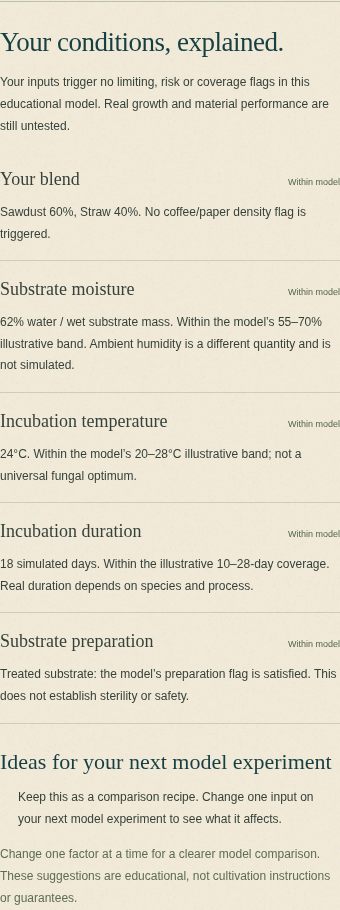 | 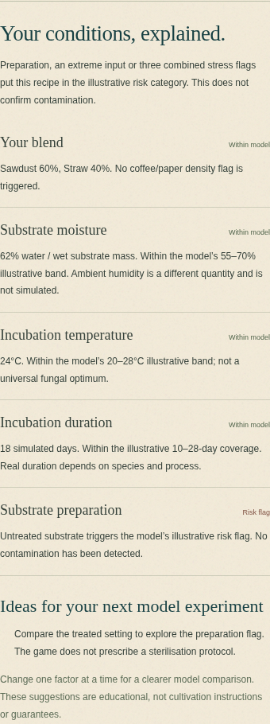 |

## Verification and review

Validation completed: **25 unit tests**, the **24-test full Chromium suite**, focused rechecks of the final focus/profile adjustments, the production build and `git diff --check` passed. Stage/profile captures and extracted recording frames were visually inspected against the reference's loop-forming and coarsening behaviour.

Run `npm test`, `npm run build`, and `npm run test:e2e`. Browser checks cover all four profiles/outcomes, reference success, ongoing motion after assessment, expanded-view continuity, paused close/reopen, deterministic Replay/Skip, clipping, visibility pause, static fallback, saved feedback, notebook retention, fresh starts, inline recipes, gestures, responsive layouts and the existing deployment-update fixture.

Review branch: `refine/physarum-network-feedback`. Preview using `npm run dev -- --port 5173` and open `/Blue-Green/` on port 5173. No merge or production deployment is performed automatically.
