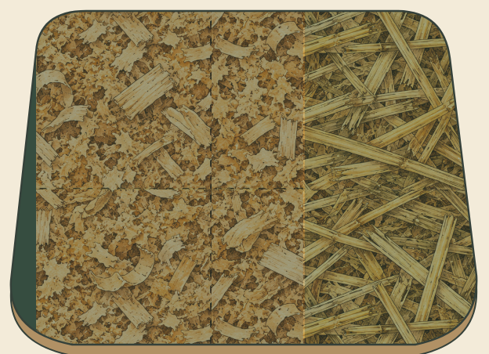
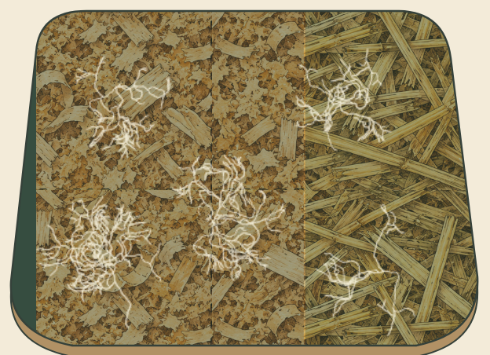
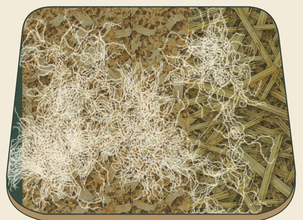
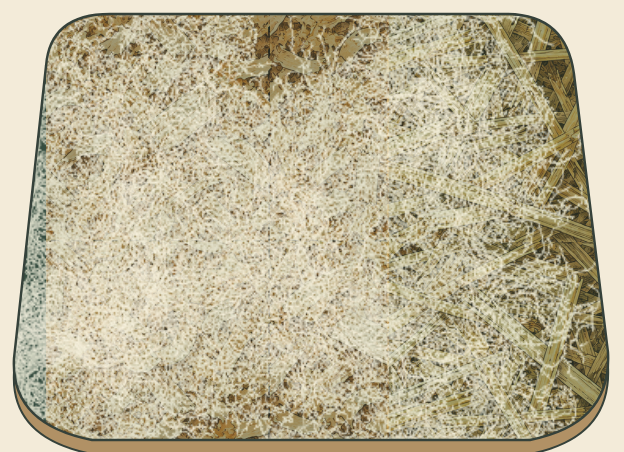
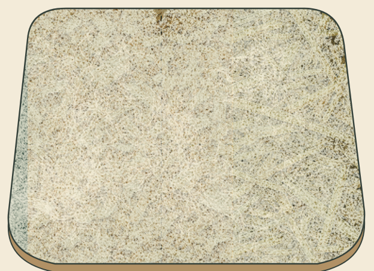
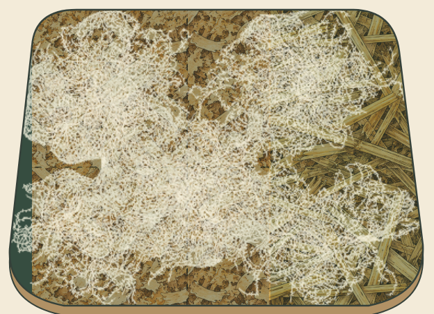
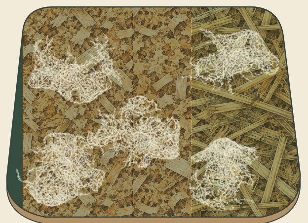
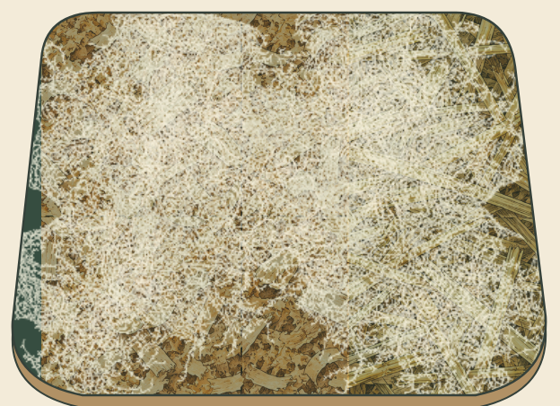

# Progressive mycelium colonisation — review

This branch replaces moving, evaporating Physarum trails with persistent branching growth. It starts from `main` at `a20d7d1` (merged PR #6). The website’s scenes, ingredient controls, visitor initialization, history, notebook, scientific evaluator and Pages configuration are preserved.

## Actual browser evidence

[Watch the full transition](review/colonisation/transition.mp4). This is one continuous, approximately 22-second Chromium recording at 390 × 844: exposed substrate, emergence, spreading, a closer view of the **same** network, Pause/Resume, complete colonisation and return to the glass vessel. It is not assembled from checkpoint images. [Recording metadata and interaction times](review/colonisation/recording.json).

The recipe is sawdust 60%, straw 40%, substrate moisture 62%, temperature 24°C, 18 days and treated substrate. Captures use device scale factor 2. The five checkpoint screenshots below are actual browser output reconstructed at exact paused sequence checkpoints using that same recipe and seed. They are not painted illustrations or opacity variations of one image.

| 0% — original substrate | 25% — sparse emergence | 50% — branching and connections |
| --- | --- | --- |
|  |  |  |

| 75% — dense expanding growth | 100% — near-complete favourable ending |
| --- | --- |
|  |  |

Full mobile scenes, including the preserved glass, reflections, illustrations and stage controls: [0%](review/colonisation/stage-0-screen.png), [25%](review/colonisation/stage-25-screen.png), [50%](review/colonisation/stage-50-screen.png), [75%](review/colonisation/stage-75-screen.png), [100%](review/colonisation/stage-100-screen.png).

| Favourable Growth | Incomplete Growth | High Contamination Risk | Unverified Combination |
| --- | --- | --- | --- |
|  |  |  |  |

Risk is not visually diagnosed contamination. The partial and restricted footprints are artistic choices, not maps of a biological process. The reference inputs remain Favourable Growth; the other captures change moisture to 45%, treatment to untreated, or incubation to 32 days respectively. Classification rules have not changed.

## Growth behaviour

Five recipe-seeded inoculation sites create small growing tips. Tips extend with gentle directional variation, favour open space and branch from their existing positions. Formed strokes accumulate permanently in a retained raster. Meeting paths join; new fine branches also sprout **from already formed filaments into adjacent gaps**. Those attached branches provide late density instead of a white overlay, moving dots or an opacity fade.

Early structural fibres remain above a slightly warmer infill layer. Both layers are accumulated filament strokes, with varied fine widths and limited local ink opacity so the mature layer retains fibres and underlying material texture. No diffusion, evaporation or disappearing-trail cycle remains. There is no pre-rendered mycelium photograph or white background fill.

The engine’s raster mask follows the existing substrate outline; the final Canvas also clips to its exact `Path2D`. The texture bounds now encompass the entire substrate, including the curved edges. The illustrated outline and glass reflections remain above growth. White ink does not enter the empty glass.

| Sequence phase | Timing | Behaviour |
| --- | --- | --- |
| Initial Growth | 0–15% | Bare substrate first; several tiny sites gradually emerge |
| Spreading Hyphae | 15–45% | Fine persistent branches extend from the sites |
| Network Formation | 45–80% | Neighbouring branches meet and finer attached branches fill gaps |
| Full Colonization / Growth Assessment | 80–100% | Outcome-specific density; favourable growth approaches a continuous soft layer |

The sequence lasts **16 illustrative seconds** without pauses. Completion leaves a stable final frame. Play/Pause works during growth; Play is disabled at completion, while Replay and View Results remain available. Replay clears the visual back to the original substrate. Skip reconstructs the exact seeded ending in bounded work slices and presents it atomically, so it does not show an unsolicited accelerated replay to reduced-motion users. Reduced motion starts paused.

The expanded view shares the same model and ink buffers. Pause freezes exact visible pixels; Resume continues from that state. Resize changes only the display buffer. Reload reconstructs the saved sequence checkpoint rather than serializing pixels; in-tab Pause/Resume retains the exact raster. No completed notebook record is rewritten or reevaluated.

## Artistic targets, not experimental measurements

Configuration is documented in `src/growthModel.js`. The source-mask diagnostic counts cells with accumulated alpha of at least 0.35, divided by cells inside the substrate outline. That cutoff and the following targets are arbitrary **artistic controls**; they are not measured colonisation, success probabilities or laboratory criteria. Actual displayed pixels also depend on antialiasing and scaling.

| Sequence checkpoint | Favourable source-mask coverage |
| --- | --- |
| 0% | 0% |
| 25% | 6.1% |
| 50% | 32.7% |
| 75% | 70.1% |
| 100% | 93.5% |

The incomplete, risk and unverified endings target approximately 52%, 20% and 63% respectively. These values deliberately communicate different illustrative endings. They are not biological predictions. [Exact capture diagnostics](review/colonisation/stages.json).

A piecewise development curve requests additional filament generation; it never changes a whole image’s opacity. The favourable run performs approximately 89,593 procedural stroke operations, including overlapping segments and attached infill. That is an implementation count, not a number of biological hyphae.

`src/simulation.js`, its thresholds, model version and the four categories are unchanged. Two explanatory references to the old Physarum artwork now describe the current stylised imagery. Earlier reference attribution and its MIT license are retained for provenance. No new research calibration is claimed.

## Mobile performance

The model uses bounded typed arrays and at most 512 active tips. The normal mobile field is 384 × 264, the low-memory tier is 256 × 176 and desktop can use 512 × 352. Quality stays fixed through Replay and expanding/resizing. No runtime dependency was added.

Only changed pixels update the retained RGBA buffer. Only the visible observation surface is painted. Work is sliced at a nominal 7 ms, at most 16 model steps per frame; the current step may finish past that limit. Hidden tabs stop scheduling work, and completed growth stops scheduling frames.

Measured production-build observations use 390 × 844, device scale factor 2, expanded view and the full favourable sequence with one Pause/Resume near halfway. Early and late samples cover approximately eight seconds each, without simultaneous browser tests or video encoding. [Full measurements](review/colonisation/performance.json).

| CPU emulation | Source field | Early frame interval p50 / p95 | Late frame interval p50 / p95 | Late work p95 | Pause round trip |
| --- | --- | --- | --- | --- | --- |
| 1× | 384 × 264 | 16.7 / 16.7 ms | 16.7 / 16.8 ms | 0.9 ms | 52 ms |
| 4× | 384 × 264 | 16.7 / 16.8 ms | 16.7 / 33.2 ms | 5.7 ms | 113 ms |

The 4× late sample includes an 83.4 ms maximum frame interval; this is not a locked frame-rate claim. Both runs reach the same 93.5% target with identical stroke counts. Whole-page JS heap samples were about 12.0 and 12.4 MB, not retained-memory/leak measurements. These desktop Chromium emulations do not replace physical-phone benchmarks or guarantee performance on every device.

## Validation and local review

**26 unit tests**, the complete **25-test Chromium suite**, the production build and `git diff --check` pass. Five exact checkpoints are checked in a real browser for increasing coverage and nondecreasing pixel alpha. The full transition and all outcome endings were also visually inspected; completion is not based only on test output.

Regression checks include natural completion matching Skip pixel-for-pixel, stable completion, exact Pause/Resume, Replay clearing, shared expanded view, paused resize, clipping, hidden-tab suspension, reduced motion, the existing static Canvas fallback, visitor resets, inline controls, stirring, conditions, Reference Recipe, all scientific outcomes, history/privacy, notebook comparison, responsive layouts and deployment-update fixtures.

```sh
npm ci
npm test
npm run build
npm run test:e2e
npm run dev
```

Open `/Blue-Green/` on development port 5173, or run `npm run preview` and open the same base path on port 4173. In a cloud workspace, use the forwarded port address. This PR does not merge into `main` or change production Pages deployment settings.
