# Review captures

Captured in Chromium at a 390 × 844 viewport, using the production build under `/Blue-Green/`. Full-page images include content below the fold. These are illustrative simulation screens, not physical experiment results.

## Recipe interaction

| Empty new experiment | Two selected ingredients |
| --- | --- |
| 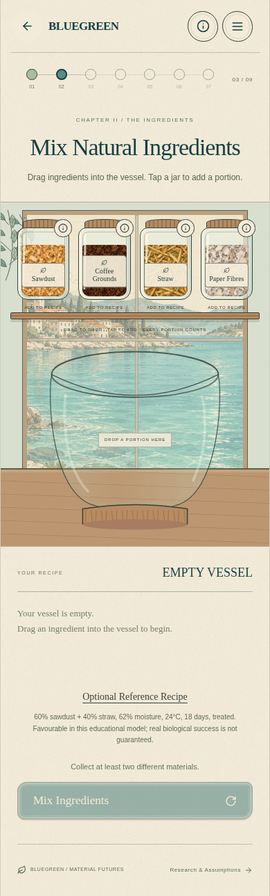 | 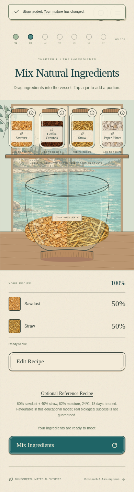 |

| Exact percentage editing | Ready to mix |
| --- | --- |
| 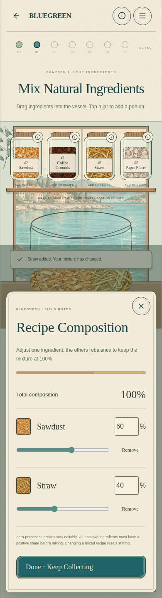 | 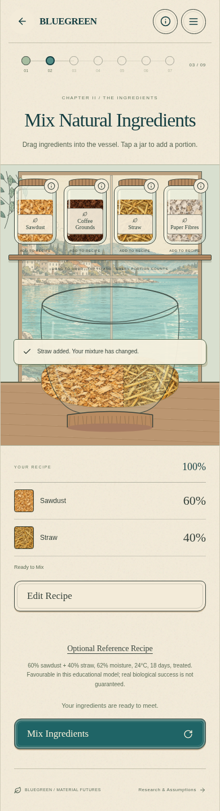 |

## Growth sequence

[Watch the short growth recording](growth-preview.webm).

| Preparation | Early development |
| --- | --- |
| 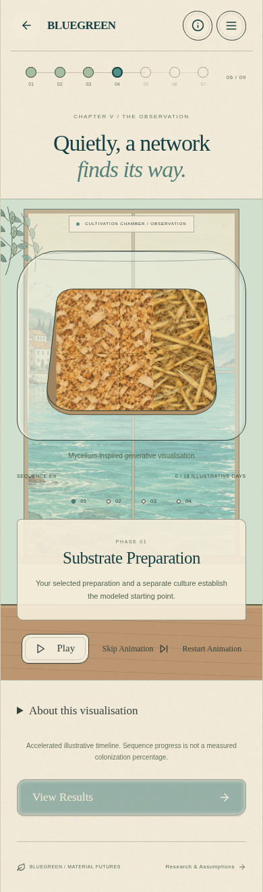 | 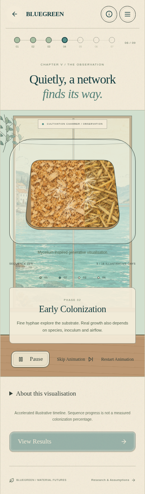 |

| Network formation | Assessment |
| --- | --- |
| 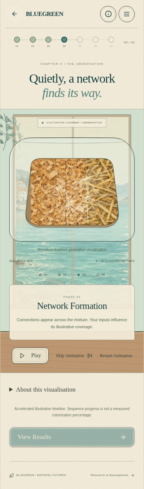 | 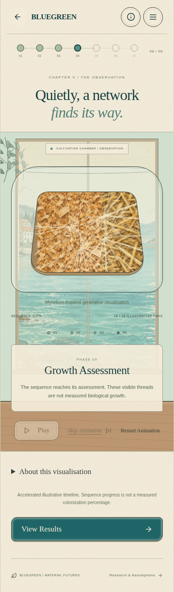 |

## Other illustrative profiles

| Incomplete | Risk | Unverified |
| --- | --- | --- |
| 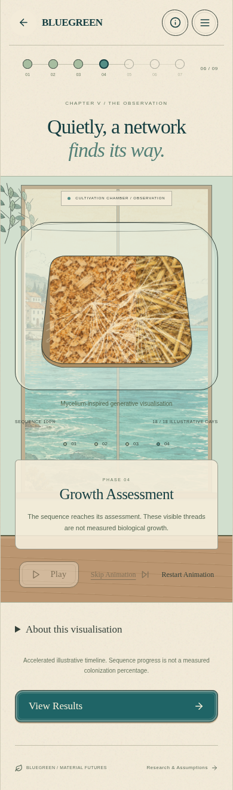 | 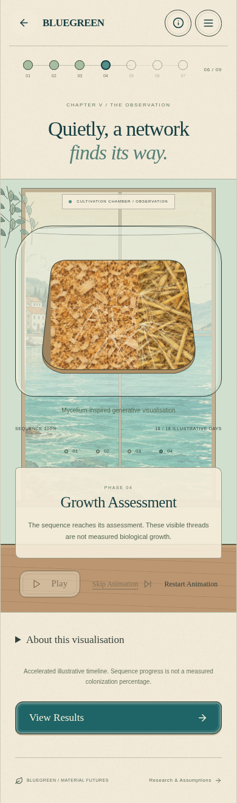 | 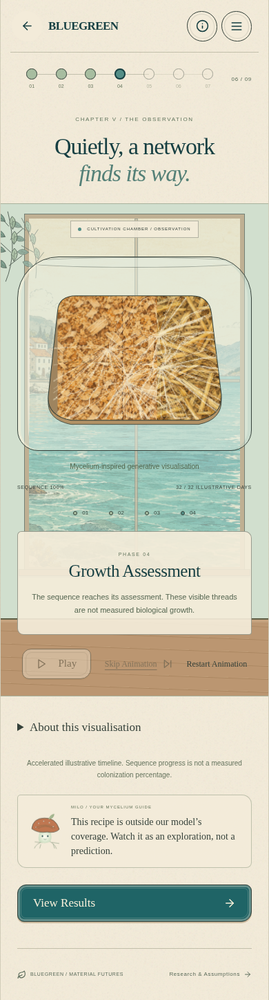 |

The animation is inspired by agent/trail models of Physarum, which is not fungal mycelium. Its appearance never changes the educational outcome rules.
