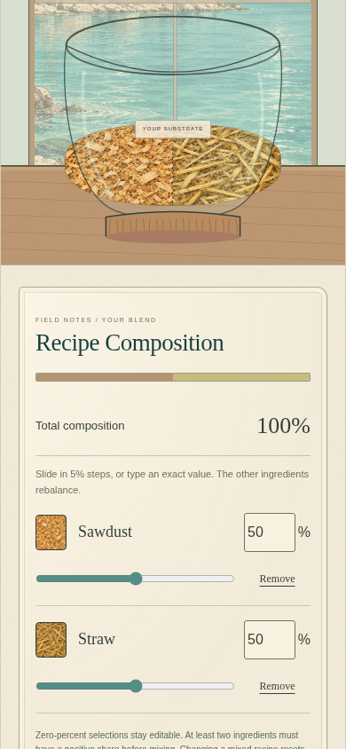
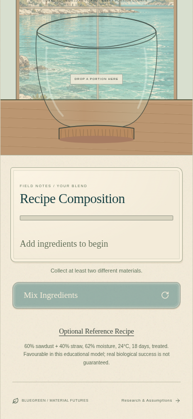

# Visitor starts and inline recipe controls

## Cause and changes

Previously, Enter the Laboratory and Begin Experiment changed only the screen number. The active draft could still contain the previous visitor's ingredients, conditions, stirring/growth progress and result ID, including active work restored from this tab's sessionStorage.

Both buttons now start a visitor explicitly: replace the active draft with `freshDraft()`, clear the active result and recovery candidate, stop playback/stirring timers and reset replay state. Notebook history, privacy preference and experiment numbering are retained. New-experiment actions also reset only active work; existing discard confirmation remains for unfinished work.

The RecipeDrawer component and its opening/closing interaction have been removed. A named, inline Recipe Composition section follows the mixing scene in normal document flow. Empty recipes show a neutral bar and “Add ingredients to begin”, without invented percentages. Selected materials show 5% range controls, precise integer inputs and direct Remove actions. The composition bar and vessel layers update immediately; nonempty recipes total 100%. Two positive ingredients are required for mixing. Editing during stirring stops its timer and invalidates the earlier mix.

The optional Reference Recipe, scientific thresholds, four outcomes, growth model, artwork and Pages deployment workflow remain unchanged.

## Explicit recovery policy

| Action                                                           | Active experiment                                                      | Completed notebook                                     |
| ---------------------------------------------------------------- | ---------------------------------------------------------------------- | ------------------------------------------------------ |
| Enter the Laboratory                                             | Always reset; proceed to introduction                                  | Retained                                               |
| Begin Experiment                                                 | Always reset; enter an empty vessel                                    | Retained                                               |
| New experiment / Explore Another Recipe / Run Another Experiment | Reset active work; confirm if an unfinished recipe would be replaced   | Retained                                               |
| Back / Review Recipe within the same experiment                  | Preserve current recipe and conditions                                 | Retained                                               |
| Return to Welcome                                                | Keep current work available for explicit recovery                      | Retained                                               |
| Resume Previous Experiment                                       | Explicitly resume that work                                            | Retained                                               |
| Refresh in this same tab, including a chosen website Update      | Recover this tab's current screen and draft; cultivation starts paused | Retained                                               |
| Open a fresh tab/session                                         | Begin at Welcome with a blank active draft                             | Load device history according to notebook privacy mode |

Reload recovery does not change what Enter/Begin do. Returning to Welcome, reloading there and choosing Enter still starts empty. Legacy unfinished local drafts are offered through the same explicit Resume action. No storage keys are cleared, and completed records are never reevaluated or pruned by this change.

## Browser evidence

Validation completed: **22 unit tests and 22 Chromium browser tests passed**, along with the production build and `git diff --check`. The complete browser suite was rerun after updating its old empty-vessel label assertion.

The regression suite checks first entry, two-material selection, 5% keyboard adjustment, exact input, 100% totals, immediate vessel-layer updates, fresh starts from Welcome, Begin after Back, same-tab refresh, explicit Resume, Back/review preservation, restarting after a completed result, notebook opening/comparison, direct removal and absence of a recipe dialog. It also checks editing while Auto Mix is active, touch dragging and no horizontal overflow at 320, 390, 768 and 1440 pixels.

The following are actual Chromium captures with a **390 × 844** viewport. Each link also has a full-page companion showing the complete jars–vessel–controls–Mix Ingredients sequence on one scrollable page.

| Empty initial vessel                                                          | Selected ingredients                                                            |
| ----------------------------------------------------------------------------- | ------------------------------------------------------------------------------- |
|  |  |
| [Full page](review/visitor-inline/empty-full.png)                             | [Full page](review/visitor-inline/two-ingredients-full.png)                     |

| Adjusted 60/40 recipe                                                       | Returning as a new visitor                                                                       |
| --------------------------------------------------------------------------- | ------------------------------------------------------------------------------------------------ |
|  |  |
| [Full page](review/visitor-inline/60-40-full.png)                           | [Full page](review/visitor-inline/returning-visitor-full.png)                                    |

Review branch: `fix/visitor-start-inline-recipe`. Run `npm test`, `npm run build`, and `npm run test:e2e`. Preview locally using `npm run dev -- --port 5173`, then open `http://localhost:5173/Blue-Green/`; forward port 5173 if using a remote workspace. Publishing this branch is not required to preview it, and the pull request must be reviewed before merging.
